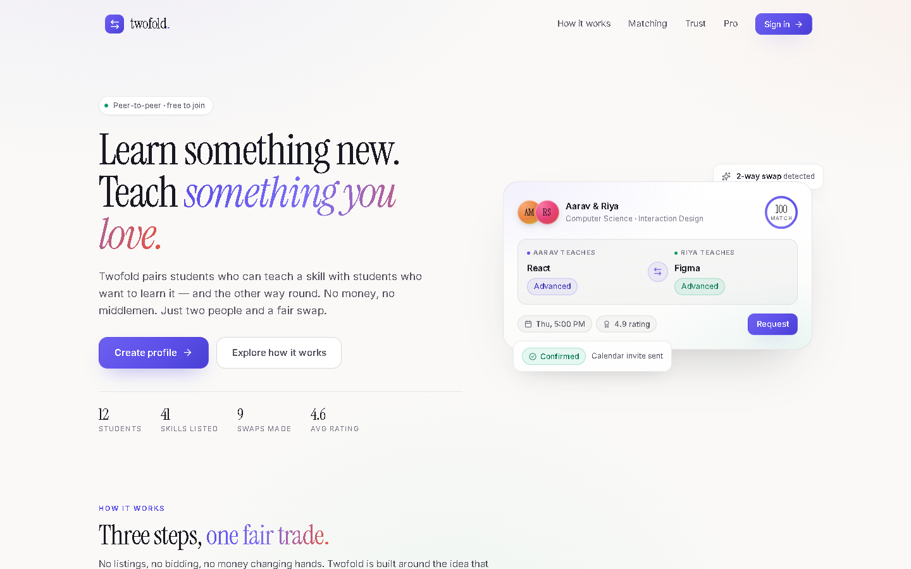
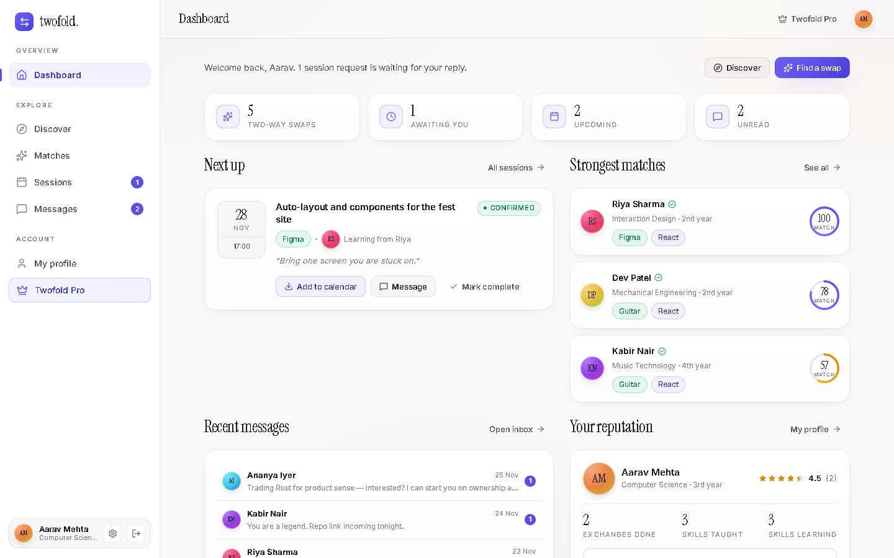
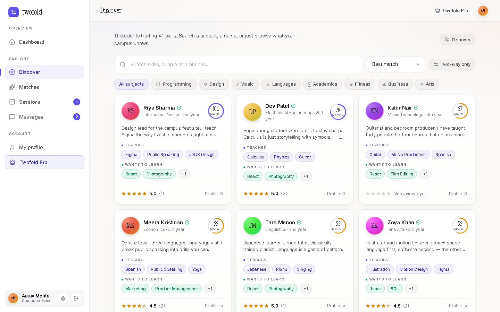
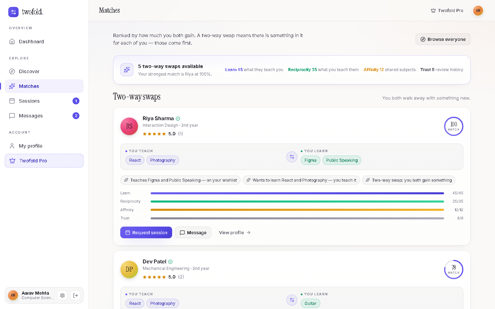
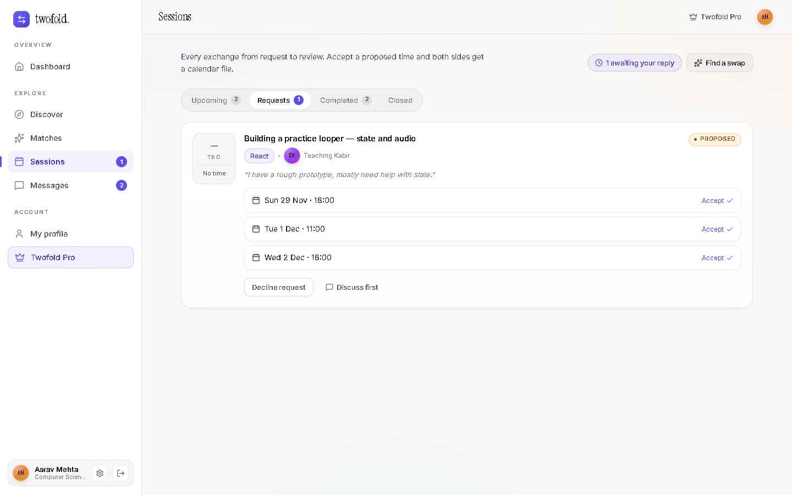
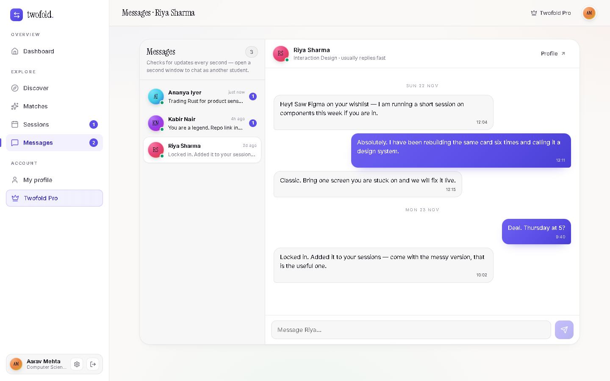
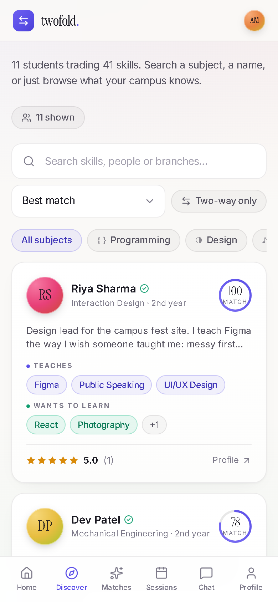

# Twofold

**A peer-to-peer skill exchange for students.** Teach what you know, learn what you don't —
a fair two-way swap, no money involved.

Built for a marketplace-style web app connecting
students who can teach a skill with students who want to learn it, with matching, chat,
scheduling, calendar sync, reviews and a sandbox premium tier.



> **One command.** Clone → `npm install` → `npm run dev`. That builds the Java backend and
> starts Spring Boot plus Vite together; the browser sees one origin (`:5173`) because Vite
> proxies `/api` to `:8080`. No API keys, no database install, no migration step.

---

## Requirements

| Need | Version | Why |
|---|---|---|
| **JDK 21** | Temurin 21 (LTS) | The backend is Spring Boot 4.2 on Java 21; the wrapper supplies Maven, not the JDK |
| **Node 20** | 20+ | Builds the React app (`engines: >=20`). Built and tested on Node 20; the frontend has no native dependencies, so newer majors normally work too but are untested here |

Nothing else — no Docker, no database server, no environment variables. The backend
embeds **SQLite** and keeps its data in `backend/twofold.db`, created and seeded on first
boot (outside `target/`, so rebuilds cannot wipe it).

## Quick start

```bash
npm install
npm run dev          # builds the jar if needed, then Spring Boot :8080 + Vite :5173
```

Open **http://localhost:5173**. Health check: **http://localhost:8080/actuator/health**.

```bash
npm run build        # typecheck + production React bundle
npm run preview      # :4173, still proxying to a running backend
npm run typecheck    # tsc --noEmit
npm run db:reset     # delete the database; next boot creates and seeds it
```

### Backend commands

```bash
export JAVA_HOME="/path/to/temurin-21"
cd backend
./mvnw spring-boot:run          # API only, :8080 (reset disabled by default)
./mvnw -B verify               # 89 tests + JaCoCo coverage
./mvnw -B -DskipTests package  # fat jar (~37 MB)
```

**Stop any running jar before packaging** — on Windows the repackage rename fails while a
JVM holds the file, which silently leaves a thin jar behind.

### Seed data

The seed (12 students, 41 skills, 12 sessions — 9 completed, 2 confirmed, 1 proposed — 14 reviews, 9 messages)
lives in `backend/src/main/resources/seed.json`; timestamps are shifted to "today" at boot,
so "in 3 days" always reads correctly. It is **content, not accounts**: the seeded students
have no password and cannot sign in — you create your own account and the profiles are
people to discover, message and swap with. Six of the twelve profiles:

| Student | Branch | Teaches | Wants to learn |
|---|---|---|---|
| Aarav Mehta | Computer Science | React, Product Management, Photography | Public Speaking, Figma, Guitar |
| Riya Sharma | Interaction Design | Figma, Public Speaking, UI/UX | React, Photography, Marketing |
| Ananya Iyer | Computer Science | Rust, Python, Machine Learning | Product Management, Figma |
| Kabir Nair | Music Technology | Guitar, Music Production, Spanish | React, Film Editing |
| Meera Krishnan | Economics | Spanish, Public Speaking, Yoga | Marketing, Product Management |
| Zoya Khan | Fine Arts | Illustration, Motion Design, Figma | React, SQL |

---

## Accounts and reset

Authentication is real and server-side (`POST /api/auth/register` / `/api/auth/login`,
BCrypt hash, HttpOnly session cookie). There is **no shared password and no demo account**:
the only way in is to create a profile with an email and a password of 8+ characters, then
sign in with either that email or the derived handle. The session survives restarts and
signing out deletes it server-side; a signed-out visitor can still read the public landing
page and its `/api/stats` summary, but every other read returns `401`.

```bash
# Register the first account in the browser, or from a terminal:
curl -s -X POST http://localhost:8080/api/auth/register \
  -H 'Content-Type: application/json' \
  -d '{"name":"Priya Nambiar","email":"priya@campus.edu","password":"at-least-8"}'
```

### Reset (development only)

`POST /api/reset` wipes every table and rewrites the seed at `version + 1`. It is **off by
default** — `twofold.reset.enabled=false` in `backend/src/main/resources/application.properties`
— so the shipped build answers `403` and can never expose a data wipe by accident.

| Where | How reset is enabled |
|---|---|
| Local dev loop | `scripts/dev.mjs` (i.e. `npm run dev`) starts the API with `TWOFOLD_RESET_ENABLED=true` |
| Java tests / smoke suite | Set the property themselves (`twofold.reset.enabled=true`) |

Everything else, including `./mvnw spring-boot:run` and a plain `java -jar`, keeps the
fail-closed default. Reset also clears credentials and live sessions, so accounts you
registered do not survive a reset — and the reseeded students still have no password.

## The 5-minute walkthrough

1. Open the app and hit **Create profile**.
2. Make an account (name, campus email, password) — you land on **My profile** with an empty
   skill list; add what you can teach and what you want to learn.
3. **Dashboard** — your two-way swaps, requests awaiting a reply, upcoming sessions, unread
   messages, your strongest matches and reputation, all on one screen.
4. **Discover** — search, filter by subject, toggle *Two-way only*, watch scores update
   (scored by the **server**, `GET /api/matches?mode=all`).
5. **Matches** — the ranking with a transparent breakdown per student
   (`GET /api/matches`), two-way matches highlighted.
6. Open a match → **Request session** → skill, topic, up to three slots → **Send request**.
7. **Sessions → Requests** — accept a proposed time (generates a calendar-ready `.ics`) or
   withdraw a request; accepted sessions move to **Upcoming** and can be marked complete.
8. **Messages** — message a seeded student; open a second browser profile with a second
   account you register to see the thread, read receipts and the one-second snapshot sync
   from both sides.
9. **Completed → Leave a review** — the review shows on their profile and re-ranks matches.
10. **My profile** — edit skills and availability, then see matches change. **Twofold Pro**
    is a sandbox checkout: ₹99/month or ₹349/semester, test tokens only
    (`tok_decline_1` shows the decline path; nothing is ever charged).

---

## Screens



| Discover | Matches |
|---|---|
|  |  |

| Sessions | Messages |
|---|---|
|  |  |

<p align="center">
  
</p>

---

## Architecture

```
┌───────────────────────────┐        ┌──────────────────────────────┐
│ React 18 + TypeScript     │  /api  │ Spring Boot 4.2 (Java 21)    │
│ Vite · :5173              │ ─────▶ │ :8080                        │
│ src/data/api.ts (seam)    │        │ http/ · matching/ · payments/│
└───────────────────────────┘        │ jobs/ · state/ · store/      │
                                     └──────────────┬───────────────┘
                                                    │ one SQLite transaction
                                     backend/twofold.db
                                     (WAL) · reminders-outbox.jsonl
```

| Layer | Where | Notes |
|---|---|---|
| UI | `src/pages`, `src/components` | Never touches storage; all data through `src/data/api.ts` |
| Snapshot cache | `src/data/store.ts` | 1-second polling while visible; version-keyed re-render |
| API | `backend/.../http/ApiController.java` | 18 routes (incl. `/api/auth/*`, `/api/stats`), `{ "error": … }` bodies, session enforcement on every read but `/api/stats` |
| Matching (D3) | `backend/.../matching/MatchEngine` | Same weights as the UI's original engine; exposed at `/api/matches` |
| Premium (D4) | `backend/.../payments` | Sandbox gateway, masked tokens, 402 on decline, no state change |
| Background job | `backend/.../jobs/ReminderJob` | `@Scheduled` session reminders → JSONL outbox, observable at `/api/reminders` |
| Persistence | `backend/.../store/JdbcStorage` + `Db` | SQLite, versioned migrations, whole snapshot in one transaction, read/write lock, monotonic version |
| Auth | `backend/.../auth` | BCrypt credentials, opaque server-side sessions, HttpOnly cookie, actor from session |

```
.
├── backend/                       Spring Boot app (Maven Wrapper)
│   ├── src/main/java/com/twofold/backend/
│   │   ├── http/                  ApiController, ApiException(Handler), Js, NoStoreFilter, SpaController
│   │   ├── domain/                User, Skill, ExchangeSkill, Session, Review, Message, Payment, Database
│   │   ├── matching/              MatchEngine, MatchService
│   │   ├── payments/              Plan, PaymentGateway, SandboxGateway, PaymentService, PremiumStatus
│   │   ├── jobs/                  ReminderJob, ReminderOutbox
│   │   ├── state/                 StateService, SeedClock
│   │   ├── store/                 Storage, Db, JdbcStorage
│   │   ├── auth/                  AuthService, AuthSession, JdbcAuthRepository
│   │   └── config/                Jackson, Scheduling, Storage
│   ├── src/main/resources/        application.properties, seed.json, db/migration/
│   └── src/test/java/…            9 suites, 89 tests
├── src/
│   ├── data/                      types, api (seam), store (snapshot), catalog, stats, useMatches
│   ├── lib/                       matching (offline fallback), ics, format, id
│   ├── pages/                     Landing, Auth, Dashboard, Discover, Matches, Profile, MyProfile,
│   │                              Sessions, Chat, ProPage
│   ├── components/                AppShell, cards, modals, MatchRing, Rating, ProPanel, Toast…
│   └── styles/                    tokens → layout → components → pages
├── scripts/
│   ├── dev.mjs                    one-command dev (jar build + both processes)
│   ├── api-smoke.mjs              95-check contract suite
│   ├── load-harness.mjs           reader/writer load + integrity checks
│   └── matches-compare.mjs        Java vs client engine parity check
└── docs/                          API, data model, UML, testing, business
```

### Design decisions

- **One document, one API shape.** `GET /api/state` returns exactly what the UI renders;
  storage and transport cannot drift.
- **Server-authoritative scoring.** The Java engine ranks matches; the local
  `src/lib/matching.ts` only paints the first frame or an offline fallback.
- **No real money, everywhere.** The Pro checkout uses deterministic test tokens; declines
  return 402 with the gateway's message and leave no ledger row.
- **Polling, not websockets.** A one-second full-snapshot poll is enough for a demo, needs
  no second process, and makes cross-tab sync visible and easy to explain.
- **Auth at the edge of every read.** The session is a real server-side row, resolved per
  request; the landing page is the only surface that works without one.

---

## Matching engine

Every candidate is scored out of 100 (`backend/.../matching/MatchEngine`, mirrored in
`src/lib/matching.ts`):

| Signal | Weight | What it measures |
|---|---|---|
| **Learn** | 45 | How many of *their* teachable skills are on *your* wishlist |
| **Reciprocity** | 35 | How many of *your* teachable skills are on *their* wishlist |
| **Affinity** | 12 | Shared subject areas, so adjacent interests surface too |
| **Trust** | 8 | Their review history (new students get a neutral 60 %) |

Learn and reciprocity saturate at two skills. Scores are never stored — adding a review or
editing skills re-ranks everything immediately, and every card shows its own breakdown.

## Calendar sync

A confirmed session exports a standards-compliant `VCALENDAR` (`src/lib/ics.ts`) with
`DTSTART`/`DTEND`, a 30-minute alarm, organiser and attendee — imports into Google, Apple
and Outlook calendars, no OAuth, works offline.

---

## Cloud deployment (decided, not yet built)

On **2026-11-25** the team chose the cloud shape: one **Render Free** Docker web service
(serving the React build from the same jar) + **Neon Free Postgres** for durable data +
free S3-compatible object storage for nightly database backups, with **GitHub Actions**
as the CI/CD pipeline. Render and Neon accounts are already set up; **no deployment exists
yet** and the app still runs on SQLite locally.

| Piece | Choice | Free-tier limits that matter |
|---|---|---|
| Compute | Render Free web service, Docker, Singapore | 0.1 CPU / 512 MB, 750 instance-hours/mo, 5 GB bandwidth; sleeps after 15 min (~1 min wake) |
| Database | Neon Free Postgres | 1 GB storage, 100 CU-hours/mo; never paused for inactivity |
| Object storage | To be chosen (10 GB free bucket) | used only for backups, not runtime traffic |
| CI/CD | GitHub Actions on the public repo | free on public repositories |

Still to build before a URL exists: `PostgresStore`, the Dockerfile, packaging the Vite
bundle into the jar, SPA deep-link fallback, `PORT` binding, a `Secure` cookie, the CI
workflow and the backup job. The full design, risks and provisional cost table live in
[`docs/CLOUD.md`](docs/CLOUD.md). Nothing in this section is currently deployed.

---

## Testing and quality

```bash
cd backend && ./mvnw -B verify                 # 89 tests, JaCoCo
node scripts/api-smoke.mjs http://localhost:8080   # 95 contract checks
node scripts/load-harness.mjs http://localhost:8080
```

| Evidence | Result | Document |
|---|---|---|
| Unit + integration + concurrency | **89/89 passing** | [`docs/testing/TEST_SUMMARY.md`](docs/testing/TEST_SUMMARY.md) |
| Coverage | 91.6 % instructions, 78.7 % branches | `backend/target/site/jacoco/` |
| API contract | 95/95 checks | [`docs/testing/API_CONTRACT.md`](docs/testing/API_CONTRACT.md) |
| Load (SQLite build) | readers p95 149 ms; writers p95 149 ms, all integrity checks pass | `TEST_SUMMARY.md` §5 |
| Security spot-check | 1 finding (`DEF-013`, fixed); auth now covers the old "no authN" note | [`docs/testing/SECURITY_SPOT_CHECK.md`](docs/testing/SECURITY_SPOT_CHECK.md) |
| Defects | 16 logged, all verified | [`docs/testing/DEFECT_LOG.md`](docs/testing/DEFECT_LOG.md) |
| Usability | instrument ready, session pending | [`docs/testing/USABILITY_CHECKLIST.md`](docs/testing/USABILITY_CHECKLIST.md) |

Known limitations are listed in `TEST_SUMMARY.md` §7 — chiefly: no password reset or email
verification, no rate limiting or CSRF token (mitigated by `SameSite=Lax`), no account
deletion, and a single-writer SQLite database meant for one process. Every read except
`GET /api/stats` requires a session, and `POST /api/reset` is fail-closed by default.

---

## Docs

| File | What |
|---|---|
| [`docs/API.md`](docs/API.md) | Every endpoint, status code and error contract |
| [`docs/DATA_MODEL.md`](docs/DATA_MODEL.md) | Document shape, invariants, seed/reset |
| [`docs/UML.md`](docs/UML.md) | Class diagram and request flow |
| [`docs/CLOUD.md`](docs/CLOUD.md) | Chosen cloud architecture, gaps, risks and cost estimate |
| [`docs/testing/`](docs/testing/) | Plan, cases, defect log, summary, security, usability |
| [`docs/business/BUSINESS_DOCS_GUIDE.md`](docs/business/BUSINESS_DOCS_GUIDE.md) | Startup, e-commerce and compliance documents |
| [`docs/project-guide-gujarati.md`](docs/project-guide-gujarati.md) | Project walkthrough in Gujarati |

## Team

Built by  Team for the Sem 5 integrated assignment. Roles reflect primary
ownership; every feature was reviewed by at least one other member (see
`docs/business/BUSINESS_DOCS_GUIDE.md` §6.18 for the contribution matrix).

| Member | Role |
|---|---|
| **Patel Mann Sanjay** | Team Lead, Backend & Integration — architecture, domain, SQLite store, auth, API routes, docs |
| **Shah Jainam Kalpeshbhai** | Frontend & UI/UX — pages, component library, design tokens |
| **Sadhu Aaditya Manishkumar** | Matching & Scheduling — scoring engine, `.ics` export |
| **Gohel Devang Prakashbhai** | Chat, Testing & QA — smoke suite, test plan/cases, defect log |
