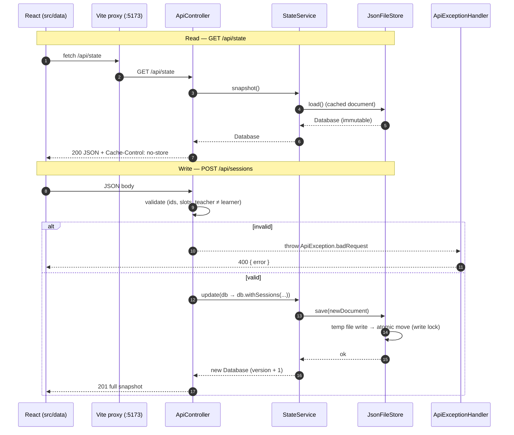
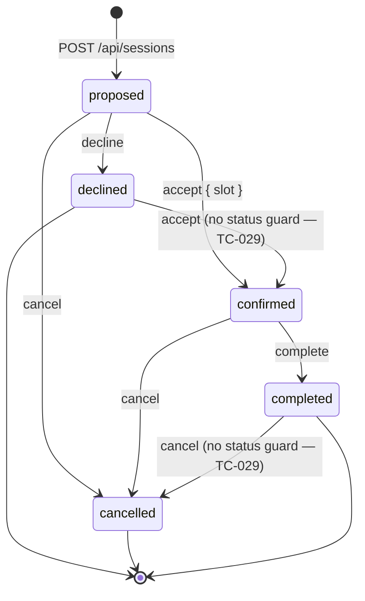
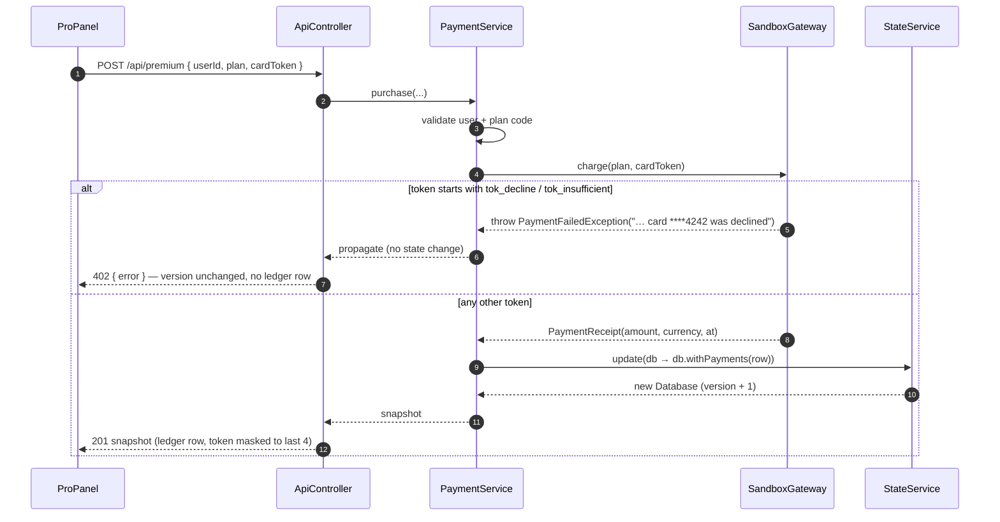
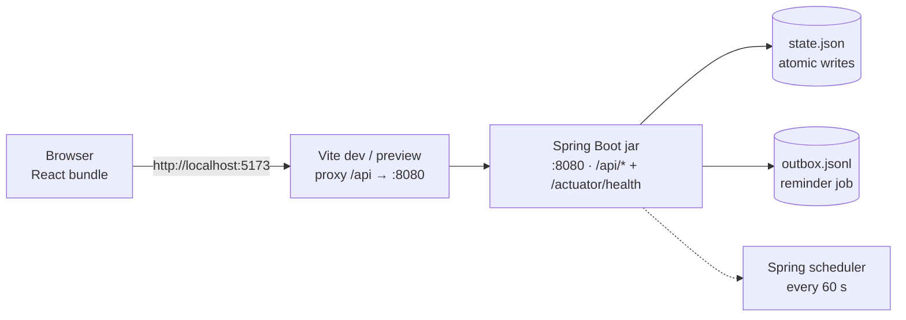

# Twofold — UML

Diagrams for the Java backend as implemented in `backend/src/main/java/com/twofold/backend`.
They are Mermaid source, so they render on GitHub, in VS Code, and in any Mermaid-capable
viewer — no exported images to go stale.

- §1 Class diagram — the domain records and the services that own them.
- §2 Request flow — what happens on a read and on a write.
- §3 Session lifecycle — the state machine tested by `TC-026`–`TC-030`.
- §4 Payment sequence — capture vs decline (`DEF-013` path included).
- §5 Deployment view (local).

---

## 1. Class diagram

```mermaid
classDiagram
    direction LR

    class Database {
      +int version
      +List~User~ users
      +List~Skill~ skills
      +List~Session~ sessions
      +List~Review~ reviews
      +List~Message~ messages
      +List~Payment~ payments
      +withVersion(int) Database
    }
    class User {
      +String id
      +String name
      +String handle
      +String email
      +String branch
      +String year
      +String bio
      +List~ExchangeSkill~ teaches
      +List~ExchangeSkill~ wants
      +List~String~ availability
      +String format
      +String joinedAt
      +int hue
      +boolean verified
    }
    class ExchangeSkill {
      +String skillId
      +String level
    }
    class Skill {
      +String id
      +String name
      +String category
    }
    class Session {
      +String id
      +String teacherId
      +String learnerId
      +String skillId
      +String topic
      +String status
      +List~String~ proposedSlots
      +String scheduledFor
      +String createdAt
      +String completedAt
      +String note
    }
    class Review {
      +String id
      +String sessionId
      +String fromUserId
      +String toUserId
      +int rating
      +String text
      +String createdAt
      +String role
    }
    class Message {
      +String id
      +String fromUserId
      +String toUserId
      +String body
      +String createdAt
      +List~String~ readBy
    }
    class Payment {
      +String id
      +String userId
      +String plan
      +int amountMinor
      +String currency
      +String cardToken
      +String status
      +String createdAt
    }

    Database "1" *-- "0..*" User
    Database "1" *-- "0..*" Skill
    Database "1" *-- "0..*" Session
    Database "1" *-- "0..*" Review
    Database "1" *-- "0..*" Message
    Database "1" *-- "0..*" Payment
    User "1" *-- "0..*" ExchangeSkill : teaches / wants
    ExchangeSkill ..> Skill : skillId
    Session ..> User : teacher / learner
    Session ..> Skill : skillId
    Review ..> Session : sessionId
    Review ..> User : from / to
    Message ..> User : from / to
    Payment ..> User : userId

    class ApiController {
      +dispatch(HttpServletRequest) ResponseEntity
      -respond(Object, int) ResponseEntity
    }
    class ApiExceptionHandler {
      +deliberate(ApiException) ResponseEntity
      +paymentFailed(PaymentFailedException) ResponseEntity
      +unexpected(Exception) ResponseEntity
    }
    class ApiException {
      +int status
      +badRequest(String)$ ApiException
      +notFound(String)$ ApiException
      +methodNotAllowed(String)$ ApiException
    }
    class Js {
      +uid()$ String
      +nowIso()$ String
      +str(Object)$ String
      +strArray(Object)$ List~String~
      +jsNumber(Object)$ double
      +falsy(double)$ boolean
      +handleFor(String)$ String
    }
    class StateService {
      -Storage store
      +snapshot() Database
      +mutate(Function~Database,Database~) Database
      +reset() Database
      +bump(Database)$ Database
    }
    class SeedClock {
      +dayShift(String, LocalDate)$ long
    }
    class Storage {
      <<interface>>
      +load() Database
      +save(Database) void
    }
    class JsonFileStore {
      -Path file
      -ReentrantReadWriteLock lock
      +load() Database
      +save(Database) void
    }
    class MatchService {
      +matches(String, boolean) List~MatchResult~
    }
    class MatchEngine {
      +computeMatches(User, Database)$ List~MatchResult~
      +scoreEveryone(User, Database)$ List~MatchResult~
      +scoreMatch(User, User, Database)$ MatchResult
      +ratingFor(String, Database)$ Rating
    }
    class MatchResult {
      +User user
      +int score
      +MatchBreakdown breakdown
      +List~ExchangeSkill~ canLearn
      +List~ExchangeSkill~ canTeach
      +boolean reciprocal
      +List~String~ reasons
    }
    class MatchBreakdown {
      +double learn
      +double teach
      +double affinity
      +double trust
    }
    class Rating {
      +double average
      +int count
    }
    class PaymentService {
      +purchase(String, String, String) Database
      +status(String) PremiumStatus
      +stats() PremiumStats
      -mask(String)$ String
    }
    class PaymentGateway {
      <<interface>>
      +charge(Plan, String) PaymentReceipt
    }
    class SandboxGateway {
      +charge(Plan, String) PaymentReceipt
    }
    class Plan {
      <<enumeration>>
      PRO_MONTHLY
      PRO_SEMESTER
      +code() String
      +amountMinor() int
      +currency() String
      +days() int
      +expiresAt(Instant) Instant
      +byCode(String)$ Optional~Plan~
    }
    class PaymentFailedException
    class ReminderJob {
      +scheduled() void
      +runOnce() ReminderStats
      +stats() ReminderStats
    }
    class ReminderOutbox {
      +append(List~String~) int
      +recent() List~String~
      +path() String
    }

    ApiController --> StateService
    ApiController --> MatchService
    ApiController --> PaymentService
    ApiController --> ReminderJob
    ApiController ..> ApiException : throws
    ApiExceptionHandler ..> ApiException
    ApiExceptionHandler ..> PaymentFailedException
    StateService --> Storage
    StateService --> SeedClock
    JsonFileStore ..|> Storage
    MatchService --> MatchEngine
    MatchEngine ..> MatchResult : returns
    MatchResult *-- MatchBreakdown
    PaymentService --> PaymentGateway
    PaymentService --> Plan
    PaymentService ..> PaymentFailedException : throws
    SandboxGateway ..|> PaymentGateway
    SandboxGateway ..> PaymentFailedException : throws
    ReminderJob --> StateService
    ReminderJob --> ReminderOutbox
    Storage ..> Database : persists
    MatchService ..> Database : reads
    PaymentService ..> Database : reads / appends
```

**Reading it:** every arrow points away from the thing that owns the decision.
`ApiController` never touches `Storage`; `StateService` never knows about HTTP; the matching
and payment services only *read* the document (payment writes go through `StateService`).
`Database` is immutable — `withVersion`, `withUsers`, etc. return a new instance, which is
why a snapshot handed to a response writer cannot be torn by a concurrent write.

## 2. Request flow

A client re-render is driven by `version`, so a failed write is a no-op by construction: no
save, no increment, and the polling tab keeps its last good snapshot.

## 3. Session lifecycle

The two dashed-by-comment transitions are **intentional Node parity**: the old API had no
`WHERE status = …` guard, so a terminal session can be re-actioned. It is documented rather
than fixed, because changing it would break contract parity for no product benefit.

## 4. Payment sequence (capture and decline)

`DEF-013` lives on the decline path: the message is built with the same `mask()` the ledger
uses, so neither storage nor errors ever expose the presented token.

## 5. Deployment view (local, this build)

Production in the cloud plan collapses Vite and the jar into one process: the built React
bundle is copied into `static/` and `SpaController` serves `index.html` for client routes,
with `/api/*` handled by `ApiController`. That packaging is **not** part of this build
(see `docs/cloud/DEPLOYMENT_PLAN.md`).
